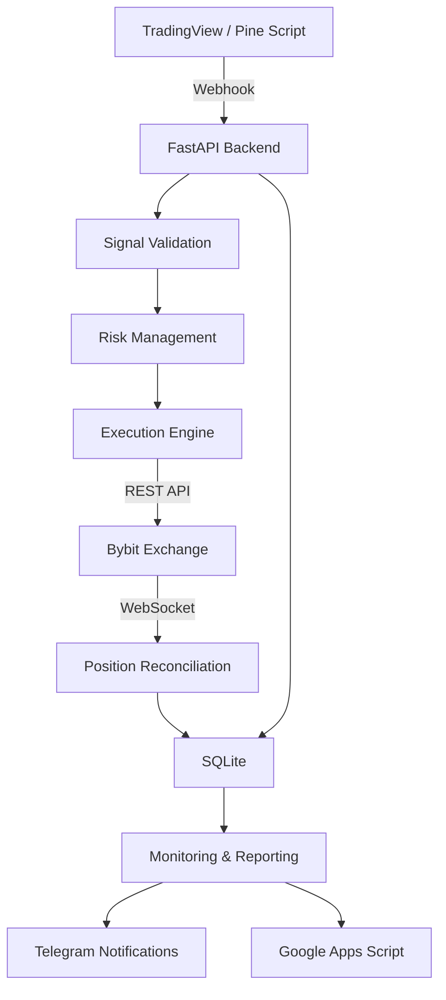

# KC Algo Lab
### Automated Trading Infrastructure & API Integration

KC Algo Lab is a private algorithmic trading infrastructure project focused on automated signal processing, exchange API integration, trade execution, and operational monitoring.

The system connects TradingView alerts to a Python-based backend, processes incoming signals, manages execution parameters, and communicates with the Bybit exchange.

The system combines Python backend services, REST API integrations, WebSocket event processing, Linux-based deployment, and automated monitoring.

## System Architecture

## Technology Stack

| Component | Technology |
|---|---|
| Backend | Python, FastAPI |
| Exchange Integration | Bybit V5 REST API |
| Real-time Communication | WebSocket |
| Trading Signals | TradingView, Pine Script |
| Data Storage | SQLite |
| Server Environment | Linux VPS |
| Service Management | systemd |
| Notifications | Telegram Bot |
| Reporting | Google Apps Script |

## Core Components

- **Signal Processing** — receiving and validating TradingView webhook alerts.
- **Risk Management** — position sizing and execution constraints.
- **Trade Execution** — communication with Bybit through its REST API.
- **Position Reconciliation** — synchronizing internal state with exchange data.
- **Monitoring** — operational notifications and event logging.
- **Data Management** — persistent records and reporting.

## Infrastructure & Operations

The backend runs on a Linux VPS as a systemd-managed service.

The infrastructure uses:
- FastAPI with Uvicorn.
- Bybit V5 REST and WebSocket integrations.
- Periodic exchange-state reconciliation.
- SQLite for persistent data.
- Telegram for operational notifications.

## Engineering Focus

The project is built around the implementation and operation of an integrated backend system, combining:

- Third-party API integration.
- Webhook processing.
- Event-driven communication.
- Backend service deployment.
- Linux server administration.
- Error handling and state synchronization.
- Monitoring and operational reliability.

## Security & Scope

This repository presents the architecture and engineering aspects of KC Algo Lab.

Proprietary trading strategy source code, internal configuration, API credentials, authentication secrets, and private operational data are intentionally excluded.

This repository is a technical portfolio case, not a public trading bot or investment recommendation.

## Project Status

Private algorithmic trading infrastructure with live exchange integration.

Further documentation and technical examples will be added progressively.
