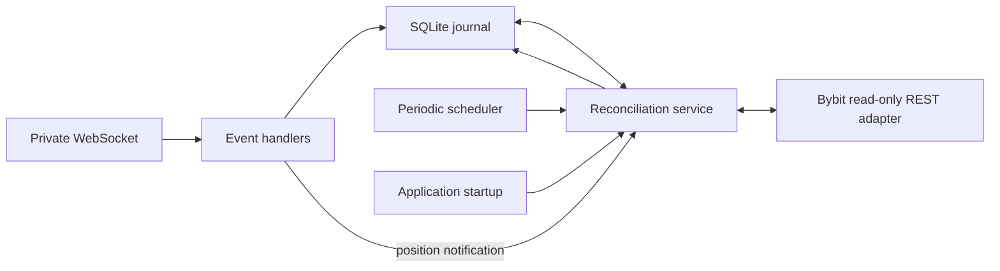

# Exchange State Reconciliation Engine

**Portfolio case study · Python · SQLite · REST API · WebSocket · Fault tolerance**

A production-oriented overview of how a Python service keeps its local order/position journal aligned with an external exchange when events can be delayed, duplicated, missed, or interrupted by process/network failures.

> **Scope and safety:** This repository is a sanitized engineering documentation, not a trading bot or a deployable exchange connector. It contains no API credentials, account identifiers, production configuration, strategy source, or live order-submission code. The `reference/` module is a small, dependency-free extraction of reconciliation policies for demonstration and testing; it is not imported by the original application.

## Problem

A REST order request can have an ambiguous outcome: the exchange may accept the order while the client loses the response. A private WebSocket can also disconnect or miss an event while the process is unavailable. If the local service treats its last observed event as authoritative, its view of orders and positions can drift from the exchange.

The system therefore combines three sources/mechanisms:

1. **SQLite journal** — durable local signal/order lifecycle and the latest exchange-position snapshot.
2. **Private WebSocket** — low-latency order, execution, position, and wallet notifications.
3. **Read-only REST reconciliation** — authoritative snapshots/lookups used at startup, after submission, after position notifications, and periodically.

The **order lookup and position-sync operations** are read-only. However, the reconciliation entry points also call the execution-based protection routine: when live execution is enabled and a position needs its fill-based protection adjustment, that routine can call Bybit `set_trading_stop` to amend the position TP/SL. The reconciliation flow does not create or cancel entry orders, but it is not globally side-effect-free.

## Architecture

See [`architecture.mmd`](architecture.mmd) for the Mermaid source.



## Reconciliation lifecycle

### 1. Startup recovery

The FastAPI lifespan initializes the database, performs a complete read-only exchange-state reconciliation, and then checks a bounded set of unresolved submissions (`order_submitted`, `submission_unknown`). This occurs before the private WebSocket is started. The startup recovery candidate limit is configurable, with a default value of 10.

### 2. WebSocket event handling

The private stream subscribes to position, order, execution, and wallet topics. Incoming messages are recorded in SQLite using a SHA-256 fingerprint of canonicalized JSON. Order events are associated with local signals by `orderLinkId`; execution events use `orderLinkId` where available and fall back to `orderId`.

A position notification triggers a fresh REST position snapshot and local synchronization. This is important: the event acts as a prompt to refresh state, while the REST snapshot is used to reconcile the current position view. The same path can also invoke the execution-based TP/SL adjustment described above.

### 3. Periodic REST fallback

A background thread runs full position reconciliation at a configurable interval (default: 60 seconds; configured range in source: 15–600 seconds). It updates the local position snapshot and derives signal transitions. This provides recovery from missed WebSocket notifications while the process remains alive.

### 4. Per-submission lookup

After a REST acknowledgement or an unknown submission outcome, a bounded worker waits according to the configured delays (default: 3, 10, and 30 seconds) and calls the read-only reconciler. The lookup searches open orders first and order history second, using symbol plus `orderLinkId`. A missing order is treated as not-yet-confirmed, not as a definitive rejection.

See [`reconciliation-sequence.mmd`](reconciliation-sequence.mmd).

## Ambiguous order submission and retry boundary

The order executor intentionally does **not** automatically retry `place_order`:

- A failure while setting leverage occurs before the order request; it is represented as a definite submission error (with a special allowance for the exchange's “leverage already configured” response).
- A transport exception during `place_order` is marked `outcome_unknown=True`, because the exchange may have accepted the request.
- The application persists `submission_unknown` and schedules read-only reconciliation.
- The follow-up process looks up the stable client order ID; it does not submit a second order.

This avoids the dangerous assumption that a timeout means the remote operation did not happen. It is a conservative retry boundary, not a claim of exactly-once execution.

## Identity and idempotency

| Identifier / mechanism | Purpose | Limitation |
|---|---|---|
| `signal_id` | Unique local signal key; duplicate incoming signals are rejected/resolved locally | Local uniqueness does not by itself make exchange requests idempotent |
| `orderLinkId` | Stable client order identifier used for exchange lookup and event-to-signal association | Correctness depends on generating and preserving a unique value per submitted order |
| `orderId` | Exchange-assigned identifier; fallback for execution-event association | Usually only known after exchange acceptance/event receipt |
| SHA-256 event fingerprint | `INSERT OR IGNORE` prevents storing an identical canonicalized message twice | Payload-based deduplication is not a general exactly-once processing guarantee; semantically identical events with different payloads may have different fingerprints |
| Notification/journal primary keys | Prevent duplicate queue rows for a signal/event | Delivery to external systems still needs its own idempotency/retry handling |

## State model and important caveats

The implementation maintains a local lifecycle, including `order_submitted`, `submission_unknown`, `partially_filled`, `filled`, `open`, `closed`, `rejected`, and cancellation/deactivation states. REST order status and the current position snapshot jointly inform transitions.

The reconciliation service docstring describes the operation as read-only, but the implementation calls `ensure_execution_based_protection()`, which can issue `set_trading_stop` when live execution is enabled. The accurate distinction is: order/position reads and local synchronization are read-only, while the bundled protection-maintenance step can amend attached TP/SL. The inspected implementation matches a position to a signal by **symbol and side**. This is adequate for the intended operating model but should be revisited before supporting multiple independent same-side positions for one symbol (for example, separate hedge/strategy ownership). The periodic reconciler uses a thread and a stop event; the source does not show a distributed lock or an explicit single-flight guard around all reconciliation entry points. Concurrent calls should therefore be considered in load/concurrency testing.

The position snapshot is replaced from the REST result. The Bybit REST adapter requests up to 200 positions per request and filters out zero-size entries; pagination behavior beyond that response is not implemented in the shown adapter. This is an operational boundary to document and test against the account/instrument scope.

## What is implemented vs. what is recommended

**Observed in the source archive**

- SQLite persistence for signals, exchange events, and current exchange positions.
- Startup full-state reconciliation and bounded recovery of unresolved submissions.
- Private WebSocket subscriptions for position/order/execution/wallet events.
- Event-to-signal mapping through `orderLinkId`, with `orderId` fallback for executions.
- REST open-order lookup followed by order-history lookup.
- Periodic REST position reconciliation.
- No automatic retry of a possibly-sent `place_order` request.
- Bounded post-submission reconciliation delays and persisted reconciliation results.
- Conditional fill-price-based TP/SL adjustment through `set_trading_stop` when live execution is enabled; this is a write side effect within the broader reconciliation path.

**Not claimed / recommended follow-up work**

- Exactly-once event processing or globally idempotent side effects.
- Distributed mutual exclusion across multiple service instances.
- Guaranteed complete REST pagination beyond the configured response limit.
- Monotonic event ordering or rejection of stale/out-of-order exchange events.
- Full multi-position attribution by strategy/trade identifier.
- Automated property-based, chaos, or multi-process concurrency coverage.

## Repository layout

```text
.
kc-algo-lab-architecture/
├── .gitignore
├── README.md
└── docs/
    └── reconciliation-engine/
        ├── README.md
        ├── architecture.mmd
        ├── reconciliation-sequence.mmd
        ├── test-plan.md
        ├── reference/
        │   └── reconciliation_policy.py
        ├── tests/
        │   └── test_reconciliation_policy.py
        └── requirements-test.txt
```

## Run the isolated reference tests

The reference policy module uses only the Python standard library. Tests require pytest.

From the repository root:

```bash
cd docs/reconciliation-engine

python -m venv .venv
source .venv/bin/activate
python -m pip install -r requirements-test.txt
python -m pytest -q
```

On Windows, activate the virtual environment using .venv\Scripts\activate in Command Prompt or .venv\Scripts\Activate.ps1 in PowerShell.

The tests validate the documented policy decisions in isolation. They do not execute the original service, call Bybit, or replace integration tests against the production adapters.

## Implementation notes

This document describes the reconciliation architecture implemented in KC Algo Lab. It covers the interaction between the reconciliation service, private WebSocket listener, Bybit REST adapter, SQLite persistence layer, FastAPI application lifecycle, and order execution workflow. The accompanying reference module and tests provide an isolated demonstration of selected reconciliation policies. The reference module is intentionally small and independently runnable. Production behavior should always be checked against the corresponding application source before future updates to this documentation.

## Technical scope

Python backend engineering · REST API integration · WebSocket event handling · SQLite persistence · distributed-state reconciliation · fault-tolerant workflows · idempotency boundaries · failure-mode analysis · automated testing
